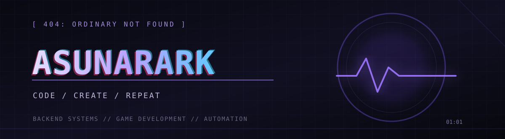

### `backend / games / late-night ideas`

`turning thoughts into systems, one commit at a time.`

---

### `> currently building`

| Project | Signal |
|:--|:--|
| **Pavilion Bot** | Discord automation · moderation · XP · OAuth2 dashboard |
| **StockPilot** | Inventory management · full-stack application |
| **Idle Dungeon Worker** | Idle RPG · progression · Godot 4 |
| **Recipe Platform** | Progressive web app · offline support · MongoDB |

Projects are being refined. Public links and demos will appear when they're ready.

### `> toolkit`

**Languages** `JavaScript` `Python` `Java` `SQL` `GDScript`

**Backend** `Node.js` `Express` `MongoDB` `SQLite` `MySQL`

**Other** `Git` `Azure` `Godot 4` `HTML` `CSS`

### `> activity.log`

`// stay curious. keep creating.`

