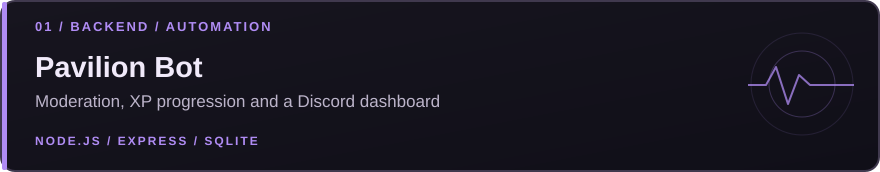
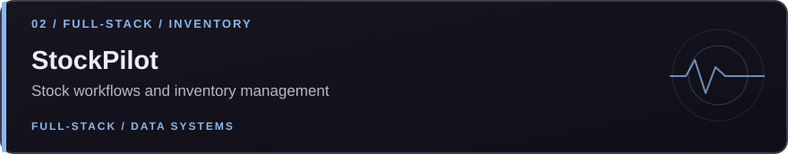
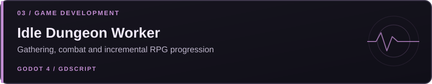
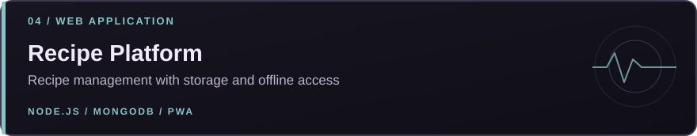

# AsunaRARK

**Software development · Backend systems · Games**

Building things that make sense, even after midnight.

 

---

## About

I develop backend services, database-driven applications, automation tools, and games. I enjoy turning ideas into practical systems — from the first prototype to something people can actually use.

## Tech stack

**Languages**

**Backend & databases**

**Tools & platforms**

---

## Featured projects

Four projects in progress. Public repositories and live demos will be added as they are ready.

---

✦ Keep building. Keep evolving. ✦

