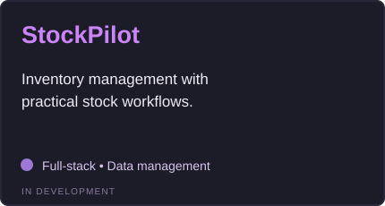
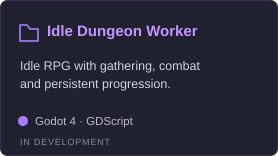
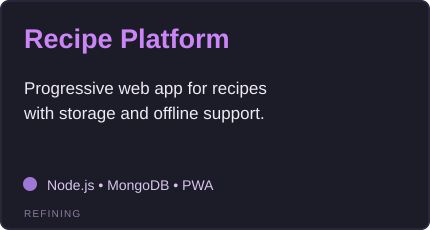

 

***Made of errors. Still running.***

 

---

## About

I’m into **code, games, and the things people build when they can’t leave an idea alone.** Some projects start with a plan. Mine usually start with *“what if?”* and get a little out of hand.

Most of my work is somewhere between **backend development** and **creative experiments** — Discord bots, databases, automation, web apps, and small games in Godot. I like the invisible parts of software: the logic, the systems, the little details that make everything click.

I break things, fix them, rewrite them, then probably break them again. **If a project is worth starting, it deserves to become more than another abandoned prototype.**

*Not chasing perfect. Just making something real.*

## Tech stack

### Languages

### Backend & databases

### Tools & platforms

---

## Featured projects

<strong>Selected projects in development.</strong> Live repository cards will replace these previews when the projects become public.

  
  
  
  

---

<strong>✦ Keep building. Keep evolving. ✦</strong>

