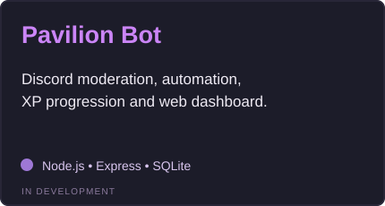
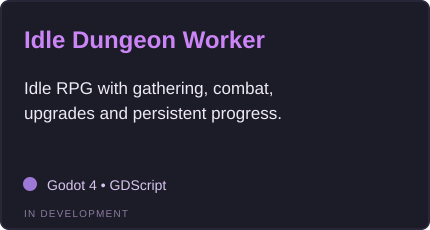

 

*Building things that make sense, even after midnight.*

 

---

## About

I build backend services, database-driven applications, automation tools, and games. I enjoy taking an idea beyond a prototype and making it genuinely useful.

## Tech stack

**Languages**

**Backend & databases**

**Tools & platforms**

---

## Featured projects

Works in progress. Public repositories and demos will be linked once they're ready.

<table>
<tr>
<td width="50%"></td>
<td width="50%"></td>
</tr>
<tr>
<td width="50%"></td>
<td width="50%"></td>
</tr>
</table>

---

✦ Keep building. Keep evolving. ✦

